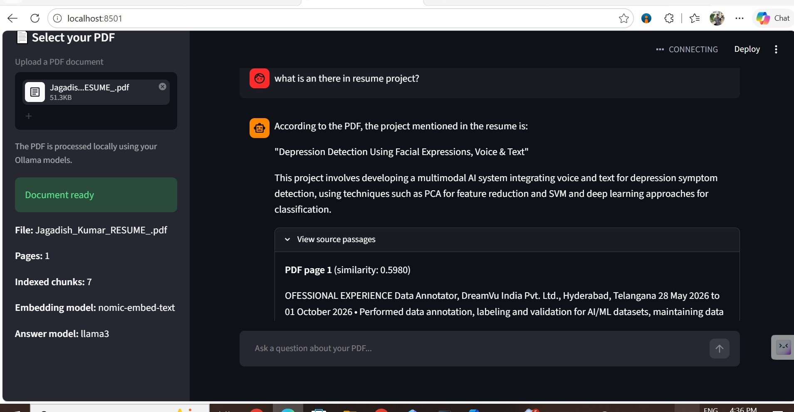

# PDF RAG Chatbot Using Ollama, FAISS and Streamlit

## Project Overview

This project is a locally running AI-powered PDF question-answering chatbot built using Retrieval-Augmented Generation (RAG). Users can upload a PDF document and ask questions about its content. The application retrieves relevant passages from the document and uses a language model to generate answers grounded in the retrieved information.

## Key Features

- Upload PDF documents through a web interface.
- Extract text using PyMuPDF.
- Split documents into smaller text chunks with overlap.
- Generate text embeddings using Ollama and `nomic-embed-text`.
- Use FAISS for vector similarity search.
- Generate answers using the Llama 3 language model.
- Display retrieved passages and PDF page references.
- Handle questions whose answers are not found in the supplied context.
- Run locally without an OpenAI API key.

## Technology Stack

- Python
- Streamlit
- PyMuPDF
- Ollama
- nomic-embed-text
- Llama 3
- FAISS
- NumPy

## RAG Workflow

1. The user uploads a PDF.
2. PyMuPDF extracts the document text.
3. The text is divided into overlapping chunks.
4. Ollama converts each chunk into an embedding vector.
5. FAISS indexes the vectors for similarity search.
6. The user's question is converted into an embedding.
7. FAISS retrieves the most relevant document chunks.
8. Llama 3 generates an answer using the retrieved context.
9. The application displays the answer and supporting passages.

## Installation and Setup

### 1. Install Python dependencies

```bash
python -m pip install streamlit PyMuPDF faiss-cpu numpy
```

### 2. Install Ollama

Install Ollama for your operating system and make sure it is running.

### 3. Download the required models

```bash
ollama pull nomic-embed-text
ollama pull llama3
```

### 4. Run the application

Navigate to the project folder and execute:

```bash
python -m streamlit run app.py
```

Open the local URL displayed in the terminal, usually `http://localhost:8501`.

## How to Use

1. Launch the Streamlit application.
2. Upload a PDF document.
3. Wait for the document indexing process to finish.
4. Enter a question in the chat input.
5. Read the generated answer.
6. Expand the source passages section to inspect the retrieved text and page references.

## Project Limitations

- Scanned PDFs that do not contain selectable text require OCR.
- Answer quality depends on document quality, retrieval relevance, and the language model.
- Similarity scores indicate vector similarity, not factual correctness.
- This version uses a basic chunking strategy and retrieves a limited number of passages.
- The application is designed for local use and has not been hardened for public production deployment.

## Future Improvements

- Add OCR support for scanned PDFs.
- Improve chunking and retrieval quality.
- Add retrieval evaluation and confidence checks.
- Support multiple document collections.
- Add automated tests and source-grounded answer evaluation.
- Deploy a suitable version for remote access.

## Author

Jagadish Kumar Thammineni

AI/ML | Generative AI | Retrieval-Augmented Generation


## Demo Screenshot




